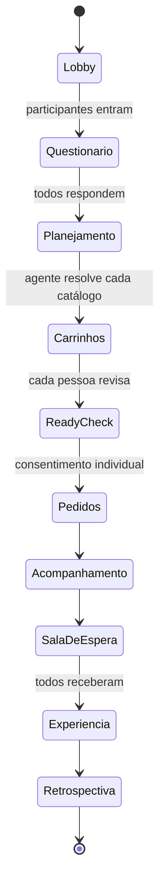
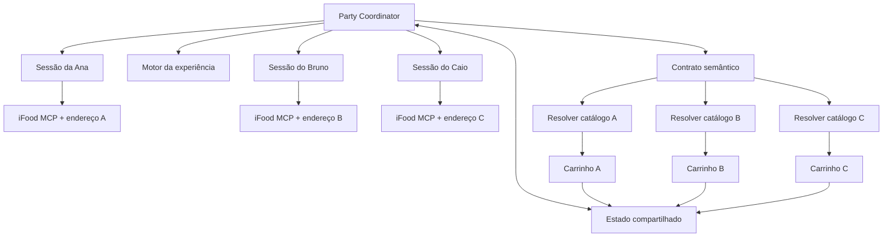

# SideQuest Party

> **Amigos distantes já dividem a tela. Com o SideQuest, eles passam a dividir a experiência.**

Projeto para o hackathon do iFood na SEMCOMP, em São Carlos.

Este README é a fonte principal de contexto para o grupo e para os agentes que colaborarem no projeto. A definição atual substitui a proposta anterior de exploração física da cidade.

## A ideia em uma frase

SideQuest é uma Party em que amigos em endereços diferentes respondem a um questionário curto, conectam suas contas do iFood e recebem pedidos personalizados que cumprem os mesmos papéis em uma experiência sincronizada.

> **O agente sincroniza significados, não produtos.**

## O problema

Amigos que vivem longe já conseguem compartilhar conversa, vídeo e jogos. Mesmo durante a mesma chamada, cada pessoa continua vivendo uma noite fisicamente diferente:

- cada participante decide sozinho o que pedir;
- catálogos, preços e prazos variam por endereço;
- combinar uma atividade exige planejamento;
- a comida chega em momentos diferentes;
- a chamada pode continuar sem uma experiência comum além da tela.

O desafio é criar uma experiência física compartilhada sem exigir que todos estejam na mesma cidade, encontrem o mesmo produto ou comprem pelo mesmo estabelecimento.

## A proposta

Uma pessoa cria uma Party e compartilha o link no Discord ou em outro canal. Cada participante:

1. entra na sala;
2. conecta sua própria conta do iFood;
3. responde a um mini questionário;
4. recebe um carrinho compatível com seu endereço, orçamento e restrições;
5. revisa e confirma seu próprio pedido;
6. acompanha a chegada dos pedidos do grupo;
7. começa a missão quando todos estiverem prontos.

Os produtos podem ser diferentes. O agente atribui a eles funções equivalentes na mesma narrativa.

| Papel na missão | Pessoa em São Carlos | Pessoa em Campinas |
| --- | --- | --- |
| Artefato picante | Salgadinho apimentado | Molho de pimenta |
| Poção desconhecida | Refrigerante diferente | Suco exótico |
| Item crocante | Biscoito | Amendoim |
| Item surpresa | Escolha local do agente | Outra escolha local |

Quando todos recebem os pedidos, os itens se tornam artefatos, pistas, ingredientes, recompensas ou desafios da mesma Party.

## Tese do produto

O SideQuest conecta duas infraestruturas que já existem:

- plataformas como Discord reúnem amigos distantes para conversar e jogar;
- o iFood materializa produtos em endereços diferentes.

O agente cria o elo entre elas, traduzindo uma experiência comum para catálogos locais.

> **SideQuest é um multiplayer do mundo físico.**

Outra forma de explicar:

> **É um DLC que chega na porta de cada jogador.**

## Público inicial

O primeiro recorte é formado por grupos de duas a quatro pessoas que:

- já se conhecem;
- estão em uma chamada ou pretendem iniciar uma;
- vivem em endereços diferentes;
- querem fazer algo além de conversar ou jogar da maneira habitual;
- aceitam comprar um kit pequeno para aquela experiência.

O MVP não tenta encontrar novos amigos nem formar grupos entre desconhecidos.

## Jornada da Party



### 1. Criação da sala

O anfitrião define nome, duração, limite de participantes, horário desejado e estilo inicial. A aplicação gera um link compartilhável. O Discord funciona como canal de voz; uma integração completa com bot não é necessária no MVP.

### 2. Mini questionário

Cada participante responde no máximo cinco perguntas:

1. **Orçamento:** até R$ 25, R$ 40, R$ 60 ou valor personalizado.
2. **Restrições:** alimentares, ingredientes indesejados e outras limitações relevantes.
3. **Categoria:** restaurante, mercado, doces e bebidas ou surpresa.
4. **Nível de surpresa:** seguro, curioso ou caótico.
5. **Clima da Party:** competir, cooperar, conversar, descobrir sabores ou improvisar.

O endereço deve vir do iFood MCP após autenticação, evitando pedir uma informação já disponível.

### 3. Contrato compartilhado

O agente consolida as respostas em um contrato semântico:

```json
{
  "party": "Caos Crocante",
  "durationMinutes": 45,
  "mode": "competitive",
  "roles": [
    { "name": "artefato_picante", "maxPrice": 15 },
    { "name": "pocao_desconhecida", "maxPrice": 12 },
    { "name": "item_crocante", "maxPrice": 10 }
  ]
}
```

Cada participante mantém suas próprias restrições:

```json
{
  "player": "Ana",
  "budget": 35,
  "dietaryRestrictions": ["vegetarian"],
  "addressSource": "ifood_mcp"
}
```

### 4. Resolução local

Para cada pessoa, o agente:

1. obtém o endereço autorizado;
2. procura estabelecimentos abertos;
3. encontra itens capazes de cumprir os papéis;
4. valida orçamento, prazo e restrições;
5. prioriza uma janela de entrega compatível com o grupo;
6. monta um carrinho individual.

O modelo pode criar a narrativa, mas não pode inventar preço, disponibilidade, estabelecimento ou característica de produto.

### 5. Ready check

Antes de qualquer compra, a sala mostra o estado de todos:

```text
PARTY: CAOS CROCANTE

✓ Ana    — carrinho pronto — R$ 31,90
✓ Bruno  — carrinho pronto — R$ 38,40
○ Caio   — escolhendo substituição

Cada participante confirma o próprio pedido.
```

Não existe uma compra coletiva atômica. O sistema coordena decisões individuais e só avança depois das confirmações necessárias.

### 6. Acompanhamento

```text
ENTREGAS

Ana      ██████████  Entregue
Bruno    ███████░░░  Em rota
Caio     █████░░░░░  Preparando
```

Enquanto esperam, os jogadores podem escolher personagens, votar em modificadores e tentar prever o que chegará para os outros.

Se um pedido atrasar, o agente pode iniciar um prólogo, reordenar etapas ou criar uma ação que não exija abrir os produtos.

### 7. Experiência sincronizada

Exemplo de primeira instrução:

> “Coloquem o primeiro pacote diante da câmera sem revelar o nome. Vocês têm 30 segundos para convencer os outros de que receberam o melhor artefato para sobreviver ao apocalipse.”

A experiência pode combinar degustações às cegas, persuasão, votação, histórias improvisadas, desafios cooperativos e comparações entre produtos locais.

## O que significa sincronizar

### Sincronização semântica

Produtos diferentes exercem o mesmo papel no jogo.

### Sincronização logística

O planejador busca minimizar a diferença entre os horários estimados de entrega, respeitando orçamento e restrições.

```text
Ana:    32–42 min
Bruno:  35–45 min
Caio:   30–40 min

Janela estimada da Party: 35–45 min
```

### Sincronização da experiência

A missão principal começa depois que todos marcarem seus kits como recebidos. Sincronizar significa coordenar o grupo; não significa enviar todas as transações no mesmo instante.

## Arquitetura conceitual



### Responsabilidades

**Party Coordinator**

- mantém participantes e estados;
- consolida o questionário;
- cria o contrato compartilhado;
- coordena ready check, entregas e início.

**Resolver individual**

- opera dentro da sessão autenticada de uma pessoa;
- consulta endereço e catálogo local;
- encontra equivalentes semânticos;
- valida orçamento e restrições;
- cria o carrinho para revisão.

**Motor da experiência**

- transforma os papéis em regras e narrativa;
- libera etapas conforme o estado da Party;
- adapta a missão a atrasos e substituições;
- gera a retrospectiva final.

## Uso do iFood MCP

| Área | Uso no SideQuest |
| --- | --- |
| User | Obter sinais de preferência quando disponíveis |
| Endereços do User MCP | Definir o catálogo e a logística de cada participante |
| Discovery | Buscar estabelecimentos e itens por categoria, preço, distância e prazo |
| Merchant e Item | Validar horário, pedido mínimo, preço e opções |
| Cart | Criar e revisar um carrinho por participante |
| Order | Acompanhar cada pedido e atualizar o estado compartilhado |

## Restrições técnicas conhecidas

- A identidade do MCP está vinculada ao usuário autenticado.
- Cada participante precisa de sua própria sessão e deve consentir com seu pedido.
- `submitOrder` exige `userConsent: true` e representa o ponto sem retorno.
- Cada carrinho pertence a um único estabelecimento.
- O MVP deve usar um estabelecimento por participante.
- Catálogos variam por endereço; itens idênticos não podem ser exigidos.
- O MCP não oferece colaboração multiusuário nativa; a Party é uma camada da aplicação.
- O MCP de pedidos permite consulta e acompanhamento, mas não devemos presumir cancelamento, suporte ou conversa com entregador.
- Informações estruturadas de alergênicos e nutrição não devem ser presumidas.
- O sandbox não realiza compras reais, mas o fluxo de consentimento deve ser demonstrado.

## Impacto

A promessa concreta é criar **experiências compartilhadas sob demanda para pessoas em endereços diferentes**.

O produto não deve afirmar que trata solidão ou melhora saúde mental. A pesquisa sustenta que conexão social é relevante, refeições compartilhadas estão associadas a bem-estar e refeições remotas podem produzir sensação de copresença. O efeito específico do SideQuest precisa ser medido.

Leia a [pesquisa de impacto](docs/pesquisa-impacto.md) para dados, fontes e limites dos claims.

### Métrica norte

> **Experiências concluídas por pelo menos duas pessoas em endereços diferentes.**

### Métricas auxiliares

| Etapa | Métrica |
| --- | --- |
| Convite | Pessoas convidadas e participantes que entraram |
| Configuração | Questionários concluídos |
| Viabilidade | Carrinhos válidos dentro de orçamento e restrições |
| Sincronização | Diferença entre horários reais de entrega |
| Ativação | Participantes presentes no início da missão |
| Participação | Pessoas que concluíram ao menos uma ação |
| Resultado | Parties concluídas |
| Qualidade | Diversão, participação e sensação de experiência comum |
| Continuidade | Intenção de repetir com o grupo |

## Escopo do MVP

### Essencial

- criar uma Party e gerar um link;
- entrada de duas ou três pessoas;
- mini questionário individual;
- contrato com três papéis semânticos;
- resolução de catálogo por participante;
- um carrinho por pessoa;
- ready check e consentimento individual;
- acompanhamento visual dos pedidos;
- uma modalidade curta de jogo;
- tratamento demonstrável de um atraso ou item indisponível;
- retrospectiva da Party.

### Se houver tempo

- narração por áudio;
- compartilhamento do resultado;
- votação durante a missão;
- modo espectador;
- integração simples com Discord;
- mais de um estilo de experiência.

### Fora do MVP

- matchmaking entre desconhecidos;
- rede social própria;
- transação coletiva atômica;
- muitos estabelecimentos por participante;
- bot completo para Discord;
- temporadas, ranking e economia virtual;
- claims clínicos sobre solidão ou saúde mental.

## Demonstração sugerida

Três participantes entram na mesma sala:

- São Carlos: orçamento de R$ 30;
- Campinas: orçamento de R$ 35;
- São Paulo: orçamento de R$ 25;
- uma pessoa vegetariana;
- todos conectados na mesma chamada.

O agente define três papéis: algo crocante, uma bebida desconhecida e um item que possa virar punição ou recompensa. Cada sessão encontra produtos locais e cria um carrinho. A interface mostra o ready check, as entregas e o início sincronizado.

Se o sandbox não permitir três contas autenticadas durante a apresentação, uma sessão pode operar ao vivo e as demais podem usar respostas do MCP capturadas previamente. A interface deve identificar claramente quais dados são reais e quais foram simulados.

## Critérios do hackathon

### Originalidade

Produtos diferentes, entregues em cidades diferentes, tornam-se componentes da mesma experiência.

### Arquitetura e engenharia

O desafio combina múltiplas sessões, resolução semântica, restrições individuais, otimização da janela de entrega, consentimento distribuído e replanejamento.

### Experiência do usuário

A metáfora da Party organiza convite, questionário, ready check, lobby, entrega e missão em um fluxo conhecido por jogadores.

### Impacto

O produto cria uma ocasião compartilhada para amizades à distância e mede participação, conclusão e percepção de experiência comum.

### Pitch

A banca acompanha produtos diferentes se transformando, ao vivo, em uma única missão.

## Princípios para o grupo e para os agentes

1. **A Party é o produto.** Recomendações e carrinhos servem à experiência compartilhada.
2. **Sincronizar significa coordenar.** Não prometer atomicidade entre pedidos.
3. **Equivalência vale mais que igualdade.** Os itens cumprem papéis comuns sem precisar ser idênticos.
4. **Cada pessoa controla sua compra.** Consentimento, orçamento e restrições são individuais.
5. **Fatos comerciais vêm do MCP.** Narrativa pode ser inventada; preço e disponibilidade não.
6. **Atrasos fazem parte do jogo.** A experiência deve se adaptar sem excluir participantes.
7. **Impacto precisa ser medido.** Usar participação e conclusão, não alegações clínicas.
8. **Uma Party completa vale mais que vários modos incompletos.**

## Riscos e respostas

| Risco | Resposta proposta |
| --- | --- |
| Produtos idênticos não existem em todas as regiões | Trabalhar com papéis semânticos equivalentes |
| Um pedido atrasa | Prólogo, reordenação de etapas e estados de espera |
| Uma pessoa não quer comprar | Só incluir no ready check após confirmação; permitir espectador depois do MVP |
| Carrinhos ficam caros | Um estabelecimento por pessoa e orçamento rígido |
| MCP não coordena contas | Manter sessões individuais sob o Party Coordinator |
| Promessa de impacto exagerada | Medir experiência compartilhada e evitar claims clínicos |
| Escopo de multiplayer cresce demais | Limitar o MVP a duas ou três pessoas e uma modalidade |

## Perguntas em aberto

- Qual será o nome final: SideQuest Party, SameQuest ou outro?
- Qual modalidade única será apresentada na demo?
- Como o participante autentica sua sessão dentro da Party?
- Qual tolerância de diferença entre entregas é aceitável?
- O MVP exige compra de todos ou permite espectador?
- Quais papéis semânticos são fáceis de resolver em diferentes catálogos?
- Como simular múltiplas contas de forma transparente se o sandbox limitar a demo?

## Pitch

> Amigos que vivem longe já conseguem compartilhar uma partida e uma conversa. Mas cada um continua vivendo uma noite fisicamente diferente. No SideQuest, eles entram em uma Party, respondem a cinco perguntas e conectam suas contas do iFood. Nosso agente cria uma experiência comum e encontra, em cada endereço, produtos diferentes que cumprem os mesmos papéis. Cada pessoa confirma seu carrinho, os pedidos são coordenados e, quando todos recebem, começa uma missão compartilhada. O SideQuest transforma delivery em multiplayer no mundo físico.

## Estado atual

Conceito aprovado pelo grupo. A próxima decisão é escolher a modalidade única da demonstração e validar o fluxo multiusuário possível no sandbox do iFood MCP.
