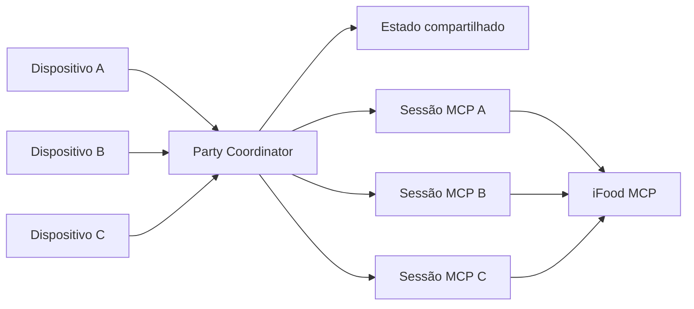

# SideQuest Party

> Amigos em lugares diferentes escolhem juntos e recebem uma experiência de pedido em comum.

Projeto do hackathon do iFood na SEMCOMP, em São Carlos.

Este README descreve a solução atual. A proposta anterior baseada em missões, papéis semânticos e jogo foi substituída e não deve orientar novas implementações.

## A ideia

Uma pessoa cria uma Party e compartilha seu código. Cada participante entra pelo próprio dispositivo, conecta a própria conta do iFood MCP por OAuth e responde a um questionário curto. A aplicação combina as respostas, sugere um tema comum, como italiano, e monta opções locais compatíveis para cada endereço.

Os restaurantes e produtos podem variar. O tema e a decisão são compartilhados; cada catálogo, carrinho, consentimento e pedido continuam individuais.

## Jornada pretendida

```text
Criar Party
→ Entrar por código
→ Fechar o grupo
→ Conectar as sessões MCP
→ Responder ao questionário
→ Sugerir e escolher um tema
→ Montar opções locais
→ Confirmar os pedidos
→ Acompanhar as entregas
```

O Júlio ainda definirá o questionário, a escolha do tema e a eventual votação. Esses detalhes não devem ser fixados no backend antes da decisão de produto.

## Primeiro recorte em construção

O primeiro recorte termina antes da escolha do tema:

```text
OPEN
→ anfitrião fecha o grupo
COLLECTING_ANSWERS
→ todos enviam respostas completas
READY_FOR_THEME
```

Critério de pronto: três dispositivos entram na mesma Party, observam os mesmos participantes, enviam respostas genéricas e recebem automaticamente `READY_FOR_THEME` quando a última pessoa termina.

Leia:

- [especificação da fundação](docs/superpowers/specs/2026-10-17-party-foundation-design.md);
- [plano de implementação](docs/superpowers/plans/2026-10-17-party-foundation.md);
- [autenticação do iFood MCP](docs/ifood-mcp.md);
- [decisão de sessões MCP](docs/adr/0001-uma-sessao-mcp-por-participante.md);
- [pesquisa de impacto](docs/pesquisa-impacto.md).

## Arquitetura atual



### Party Coordinator

- mantém sala, participantes e estado;
- entrega uma identidade temporária a cada dispositivo;
- fecha a lista de participantes por comando do anfitrião;
- guarda respostas sem conhecer o formato definitivo do questionário;
- avança estados automaticamente quando todos concluem a etapa;
- mantém tokens MCP fora do estado público.

### Sessão MCP individual

- conecta a conta do participante por autorização OAuth 2.1;
- opera endereço, catálogo, carrinho e pedido daquela pessoa;
- não compartilha credenciais com outros participantes;
- devolve resultados estruturados ao coordenador.

## Decisões confirmadas

- A demonstração usará aproximadamente três dispositivos.
- O anfitrião fecha o grupo; depois disso, as etapas avançam automaticamente.
- Cada integrante autoriza sua própria conta do iFood MCP durante a Party, por OAuth 2.1.
- Um único backend na Oracle coordena clientes MCP isolados.
- O frontend usa polling a cada 1–2 segundos; WebSocket não é necessário agora.
- A API e os tokens dos participantes ficam somente em memória durante o MVP.
- O participante usa um único botão para consentir e confirmar o pedido na etapa futura.
- Haverá fixtures previamente capturadas como contingência da demonstração.
- A primeira versão da retrospectiva resume dados agregados da Party, incluindo a maior distância entre endereços, quando todos os pedidos chegam a `CONCLUDED`; feedback fica para depois.

## Decisões ainda abertas

- perguntas e respostas do questionário;
- regra que sugere os temas;
- necessidade e formato das rodadas de votação;
- quantidade de opções apresentadas a cada participante;
- composição exata dos cardápios;
- feedback final e destaques adicionais da retrospectiva.

## Limites do primeiro recorte

Não implementar ainda:

- tema ou votação;
- cardápios e carrinhos;
- envio e acompanhamento de pedidos;
- feedback final da retrospectiva;
- banco de dados;
- WebSocket;
- login permanente;
- agentes autônomos negociando entre si.

## Desenvolvimento

Requisitos: Node.js 22 e npm 10.

```bash
npm install
npm run dev:api
```

A API usa `http://localhost:3333`. O contrato HTTP está em [`apps/api/openapi.yaml`](apps/api/openapi.yaml).

## Time

| Pessoa | Responsabilidade inicial |
| --- | --- |
| Júlio | Produto, questionário, escolha do tema, fluxos e textos |
| Otávio | Frontend multiusuário e polling da Party |
| Maeda | Sessões MCP isoladas por OAuth e validação dos tokens |
| Matheus | Party Coordinator, contratos, segurança das sessões e integração |

## Impacto

A proposta cria uma decisão e uma experiência de pedido compartilhadas para pessoas em endereços diferentes. Claims sobre conexão social e refeições remotas estão documentados com suas limitações em [docs/pesquisa-impacto.md](docs/pesquisa-impacto.md).
