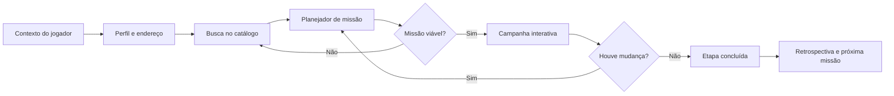
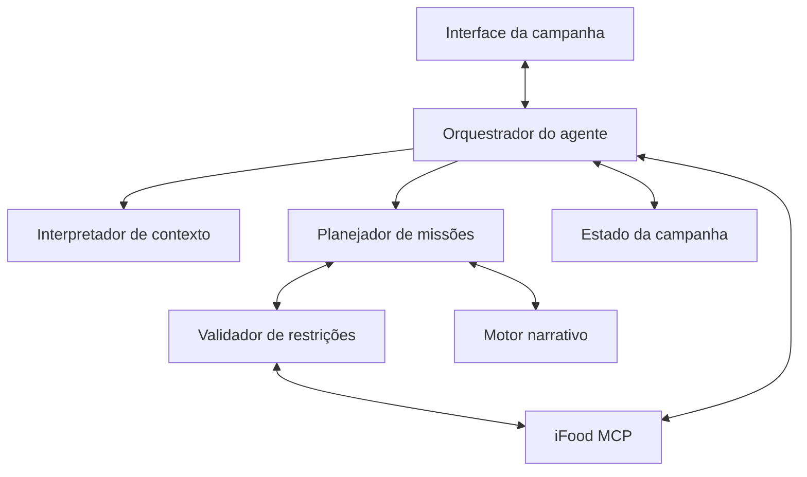

# SideQuest

> **A cidade vira um tutorial.**

SideQuest transforma o comércio disponível em uma cidade em missões personalizadas para quem acabou de chegar, está conhecendo um bairro ou quer sair da própria rotina.

O projeto está sendo desenvolvido para o hackathon do iFood na SEMCOMP, em São Carlos. Este documento serve como fonte de contexto para o grupo e para os agentes que colaborarem no projeto.

## A ideia em uma frase

Quando alguém chega a uma cidade, recebe um endereço, mas não recebe um tutorial. O SideQuest usa o iFood MCP para transformar necessidades reais — encontrar mercado, farmácia, comida e itens essenciais — em uma campanha de exploração do novo território.

## O problema

Chegar a uma cidade ou a um bairro desconhecido envolve pequenas decisões difíceis:

- Onde encontro o básico perto de casa?
- O que consigo resolver com o orçamento e o tempo que tenho?
- Quais lugares estão abertos agora?
- Como descubro opções além das escolhas mais óbvias?
- Como começo a criar familiaridade com o lugar?

Os aplicativos atuais ajudam a encontrar produtos e estabelecimentos. Eles não transformam esse processo em uma jornada coerente, memorável e adaptada ao momento da pessoa.

## A proposta

O usuário descreve seu contexto em linguagem natural:

> "Cheguei hoje em São Carlos, moro perto da USP, tenho R$ 100, uma hora livre e preciso sobreviver à primeira noite."

O agente interpreta objetivos e restrições, consulta estabelecimentos e produtos reais e monta uma sequência de missões:

1. **Construa sua base:** encontre itens essenciais sem ultrapassar o orçamento.
2. **Descubra sua taverna:** conheça uma opção próxima e aberta para comer.
3. **Encontre o healer:** identifique onde obter itens básicos de farmácia.
4. **Desbloqueie o mapa:** descubra um estabelecimento fora do padrão habitual.

Ao final, a pessoa resolveu necessidades concretas e começou a construir uma relação com o território.

## Tese do produto

O catálogo do iFood pode funcionar como matéria-prima para experiências no mundo real.

No SideQuest:

- estabelecimentos são pontos do mapa;
- produtos são artefatos;
- necessidades são objetivos;
- restrições são regras da partida;
- compras e retiradas materializam o progresso;
- imprevistos fazem o agente replanejar a campanha.

O jogo não é o problema resolvido. Ele é a interface usada para tornar a descoberta urbana mais simples, motivadora e memorável.

## Público inicial

O primeiro recorte é formado por:

- calouros e estudantes chegando a uma cidade universitária;
- pessoas morando sozinhas pela primeira vez;
- pessoas que acabaram de mudar de bairro ou cidade;
- visitantes com pouco tempo para conhecer a região.

São Carlos e a própria SEMCOMP oferecem um cenário natural para demonstrar essa jornada.

## Experiência principal

### 1. Briefing

O jogador informa:

- onde está;
- quanto pode gastar;
- quanto tempo possui;
- se está sozinho ou acompanhado;
- restrições alimentares e preferências;
- o que precisa resolver;
- o estilo desejado para a missão.

### 2. Geração da campanha

O agente consulta o iFood MCP, encontra opções viáveis e constrói uma campanha com narrativa, ordem, orçamento e critérios de conclusão.

### 3. Validação

Antes de apresentar a campanha, o agente verifica:

- estabelecimentos abertos;
- distância e prazo plausíveis;
- compatibilidade com o orçamento;
- restrições declaradas pelo usuário;
- disponibilidade dos itens;
- alternativas para etapas críticas.

### 4. Execução

A interface apresenta:

- mapa ou representação do território;
- missão atual;
- inventário;
- orçamento restante;
- cronômetro;
- progresso da campanha.

Qualquer compra exige confirmação explícita do usuário.

### 5. Replanejamento

Se um estabelecimento fechar, um item ficar indisponível ou o orçamento mudar, o agente reescreve a missão preservando a narrativa e os objetivos já concluídos.

Esse replanejamento deve ser um dos momentos centrais da demonstração técnica.

## Retrospectiva jogável

Depois de algumas jornadas, o SideQuest pode criar uma retrospectiva inspirada em jogos e em experiências como o Spotify Wrapped.

Em vez de apenas listar pedidos, a retrospectiva transforma os hábitos em uma ficha de personagem:

- classe do jogador;
- território explorado;
- horário de poder;
- item recorrente;
- nível de exploração;
- estabelecimentos que viraram "bases";
- regiões e categorias ainda não descobertas.

A retrospectiva termina gerando a próxima missão. Ela conecta passado e ação:

> "Você passou a temporada inteira no mesmo território. Sua próxima missão é descobrir uma opção fora da sua rotina, dentro de R$ 50 e a menos de 2 km."

A retrospectiva deve distinguir claramente:

- **dado observado:** informação retornada pelo MCP;
- **interpretação do agente:** conclusão inferida a partir dos dados;
- **elemento narrativo:** nome ou história criada para a experiência.

Não devemos inventar quantidades, gastos ou estatísticas históricas que o MCP não forneça.

## Uso do iFood MCP

### Capacidades relevantes já identificadas

| Área do MCP | Uso no SideQuest |
| --- | --- |
| User | Obter perfil comportamental e preferências do usuário |
| Endereços do User MCP | Definir o ponto inicial e entender padrões associados aos endereços |
| Discovery | Buscar estabelecimentos e itens por categoria, preço, distância, prazo e disponibilidade |
| Recommendations | Encontrar favoritos, pedidos recentes, ofertas e estabelecimentos locais em destaque |
| Merchant e Item | Validar horários, pedido mínimo, entrega, retirada, preço e opções do produto |
| Cart | Materializar a etapa escolhida após consentimento explícito |
| Order | Acompanhar o pedido e usar o estado da entrega no progresso da missão |

### Fluxo esperado



## Restrições técnicas conhecidas

Estas restrições devem orientar agentes e desenvolvedores:

- Cada carrinho pertence a um único estabelecimento.
- Jornadas com várias verticais podem exigir carrinhos ou pedidos separados.
- A identidade do MCP está vinculada ao usuário autenticado; não há colaboração nativa entre várias contas.
- O envio do pedido exige `userConsent: true` e deve acontecer somente após uma confirmação clara.
- O MCP de pedidos é voltado à consulta e ao acompanhamento; não devemos presumir cancelamento, suporte ou conversa com entregador.
- Não devemos depender de um histórico anual completo de compras para a retrospectiva.
- Informações como alergênicos e dados nutricionais não devem ser presumidas quando não estiverem estruturadas na resposta.
- Farmácia deve ser tratada como descoberta de produtos e estabelecimentos, sem diagnóstico ou recomendação médica.
- O sandbox não realiza uma compra real, mas ainda devemos demonstrar o fluxo de consentimento corretamente.

## Arquitetura conceitual



O planejador deve separar dois tipos de decisão:

1. **Fatos verificáveis:** preço, distância, disponibilidade, horário e restrições.
2. **Liberdade criativa:** narrativa, nomes, pistas e ordem dramática.

O modelo pode criar livremente a narrativa, mas não pode inventar fatos comerciais.

## Escopo sugerido para o MVP

O MVP deve provar uma jornada completa, não cobrir todas as possibilidades.

### Essencial

- formulário ou conversa para receber contexto, orçamento e tempo;
- leitura de endereço e sinais do perfil;
- busca real no MCP;
- geração de uma campanha com duas ou três etapas;
- validação de orçamento, distância, horário e restrições;
- interface com missão, inventário e progresso;
- um evento de replanejamento;
- criação de um carrinho após confirmação;
- resumo final da campanha.

### Se houver tempo

- modo em grupo com uma pessoa como anfitriã;
- retrospectiva visual do personagem;
- compartilhamento do resultado;
- estilos diferentes de narrativa;
- mapa real;
- histórico de campanhas.

### Fora do MVP

- rede social completa;
- multiplayer em tempo real;
- pedidos simultâneos em muitos estabelecimentos;
- gamificação extensa com moedas, ranking e temporadas;
- qualquer fluxo que dependa de recursos não confirmados no MCP.

## Métricas de impacto

O protótipo pode representar o resultado de uma campanha com métricas como:

```text
CAMPANHA CONCLUÍDA

4 necessidades resolvidas
3 estabelecimentos descobertos
R$ 92 de R$ 100 utilizados
2,1 km do território explorados
1 nova base estabelecida
```

Em uma validação real, acompanharíamos:

- necessidades concluídas dentro do orçamento;
- novos estabelecimentos descobertos;
- diversidade de categorias exploradas;
- missões iniciadas e concluídas;
- retorno posterior aos lugares descobertos;
- tempo até a pessoa concluir sua primeira campanha.

As métricas exibidas na demo devem ser derivadas da sessão. Não usar números fictícios como evidência de impacto real.

## Critérios do hackathon

### Originalidade

O SideQuest trata catálogo, localização e disponibilidade como uma game engine para o mundo real.

### Arquitetura e engenharia

O desafio técnico está em gerar missões que sejam simultaneamente narrativas e executáveis, validando restrições e replanejando diante de mudanças.

### Experiência do usuário

A metáfora de RPG transforma uma jornada complexa em briefing, mapa, missões, inventário e progresso.

### Impacto

O produto ajuda pessoas a resolver necessidades iniciais, conhecer o entorno e criar referências práticas em um território desconhecido. Para o iFood, cria uma jornada de descoberta que atravessa diferentes verticais.

### Pitch

A demonstração começa com alguém chegando a São Carlos e termina com uma campanha gerada a partir de estabelecimentos e produtos reais.

## Princípios para decisões do grupo e dos agentes

Ao propor ou implementar algo, seguir estes princípios:

1. **A missão precisa resolver uma necessidade real.** Diversão sem utilidade não sustenta a proposta.
2. **A narrativa deve nascer de dados reais.** Produtos e estabelecimentos não podem ser inventados.
3. **O jogador mantém o controle.** Toda ação comercial irreversível exige consentimento explícito.
4. **O orçamento é uma regra rígida.** Considerar itens, taxas e pedidos mínimos.
5. **Falhas fazem parte da experiência.** O agente deve replanejar sem quebrar a campanha.
6. **A interface deve mostrar o raciocínio útil.** Explicar por que cada etapa cabe no tempo, orçamento e contexto.
7. **O MVP deve contar uma história completa.** Uma campanha convincente vale mais que vários modos incompletos.

## Riscos do conceito

| Risco | Resposta proposta |
| --- | --- |
| Parecer apenas uma caça ao tesouro | Ancorar cada missão em uma necessidade concreta de quem chegou à cidade |
| Impacto pouco demonstrável | Exibir necessidades resolvidas, orçamento respeitado e estabelecimentos descobertos |
| Muitas compras e taxas | Usar uma compra principal e outros locais como descobertas ou checkpoints |
| Narrativa inventar fatos | Validar todas as informações comerciais antes de gerar a missão |
| Escopo grande para o hackathon | Demonstrar uma campanha curta com um replanejamento bem executado |
| Perfil de teste com poucos dados | Fazer o briefing funcionar mesmo sem histórico e tratar personalização como enriquecimento |

## Perguntas em aberto

- Qual será o nome final: SideQuest, Cidade Tutorial ou outro?
- A primeira versão será focada exclusivamente em pessoas recém-chegadas?
- A missão será realizada por entrega, retirada ou uma combinação das duas?
- Qual evento de falha será usado para demonstrar o replanejamento?
- A retrospectiva entra no MVP ou apenas no pitch de evolução?
- Qual visual representa melhor a experiência: mapa, jogo em texto ou painel de campanha?

## Frases de pitch

> "Hoje o iFood ajuda você a decidir o que comer. O SideQuest ajuda você a decidir o que viver."

> "Quando você chega a uma cidade, recebe um endereço. Nós entregamos o tutorial."

> "Transformamos catálogo, disponibilidade e localização em uma game engine para o mundo real."

## Estado atual

Conceito em definição. A prioridade seguinte é escolher a jornada única da demonstração e definir o recorte técnico do MVP.
