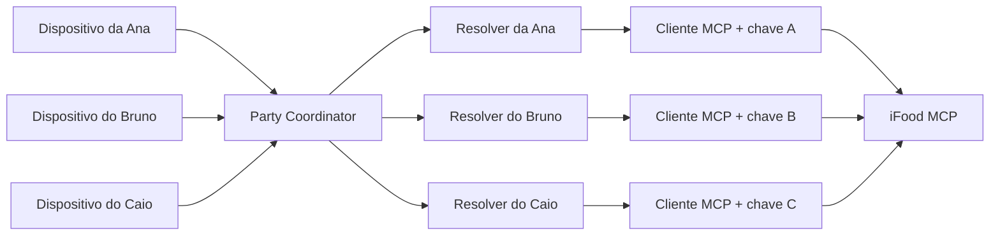

# Uma sessão MCP por participante sob um coordenador central

Cada participante da Party usará uma chave própria do iFood MCP, cadastrada durante a entrada na sala. O backend central coordenará a experiência, mas cada catálogo, carrinho e pedido será resolvido por um cliente MCP isolado e vinculado a somente um participante. Escolhemos esse desenho para preservar identidade, endereço, consentimento e carrinho individuais sem introduzir uma rede de agentes autônomos negociando entre si.

## Topologia escolhida



O **Party Coordinator** decide a missão compartilhada e envia o mesmo contrato semântico para cada resolver. Um **resolver individual** usa apenas a chave, o endereço, o orçamento e as restrições daquele participante. Ele devolve um `ResolveKitOutput` estruturado; não conversa livremente com os outros resolvers.

## Cadastro da chave durante a Party

Fluxo previsto:

1. o participante entra na Party e recebe uma identidade temporária;
2. cola sua chave MCP em uma tela privada;
3. o frontend envia a chave por HTTPS para a API;
4. a API valida a chave com uma operação de leitura do MCP;
5. a API mantém a chave somente em memória e devolve apenas o estado `connected`;
6. o Party Coordinator referencia a conexão por um identificador interno;
7. a chave é descartada ao encerrar a Party ou reiniciar o processo.

O estado público da sala pode conter:

```json
{
  "participantId": "ana",
  "mcpConnection": "connected"
}
```

Ele nunca contém a chave.

## Limites de segurança do MVP

- aceitar chaves somente por HTTPS;
- não incluir chaves em `PartySnapshot`, fixtures, prompts, logs ou mensagens de erro;
- não persistir chaves em banco ou arquivo;
- exigir o token temporário do participante para cadastrar ou substituir sua própria chave;
- manter um registro privado `participantId → MCP client`, separado do estado público;
- nunca permitir que um participante execute ferramentas na sessão de outro;
- manter `userConsent` individual no envio de cada pedido.

## Contrato entre coordenador e resolver

O Party Coordinator chama cada resolver com dados estruturados:

```ts
type ResolveParticipantKitInput = {
  partyId: string
  participantId: string
  mcpSessionRef: string
  budget: number
  restrictions: string[]
  roles: string[]
}
```

O resolver devolve o contrato `ResolveKitOutput` já definido em `packages/contracts`. A chave real é recuperada pelo backend por `mcpSessionRef`; ela não faz parte do argumento enviado ao modelo.

Os três resolvers podem ser iniciados em paralelo, mas uma falha não cancela os demais. O coordenador deve registrar o resultado de cada participante separadamente e permitir nova tentativa individual.

## Alternativas rejeitadas

### Um único cliente MCP compartilhado

Foi rejeitado porque pode misturar identidade, endereço, carrinho e consentimento entre participantes.

### Um agente autônomo em cada dispositivo

Foi rejeitado para o MVP porque exigiria execução local, coordenação agente a agente e tratamento de falhas distribuídas. O isolamento necessário pode ser obtido no backend com clientes MCP separados e contratos JSON previsíveis.

### Uma única sessão real e dois carrinhos simulados

Continua como fallback de demonstração, mas não representa o fluxo principal enquanto houver três chaves de sandbox disponíveis.

## Prova técnica obrigatória para o Maeda

A documentação conceitual não garante que a biblioteca usada aceite várias credenciais no mesmo processo. Antes da integração, executar um spike com estas verificações:

1. criar dois clientes MCP apontando para o mesmo servidor com chaves diferentes;
2. executar uma consulta de identidade ou endereço em cada cliente;
3. confirmar que as respostas pertencem aos perfis esperados;
4. repetir chamadas intercaladas para detectar vazamento de contexto;
5. testar três clientes simultâneos e registrar limites ou erros;
6. confirmar se o transporte aceita autenticação por instância, sem variável global.

Se a biblioteca mantiver a credencial globalmente, o fallback técnico será executar um processo trabalhador por chave. O contrato entre coordenador e resolver permanece o mesmo; não será necessário adotar agentes autônomos negociando entre si.

## Responsabilidades

| Pessoa | Responsabilidade nesta decisão |
| --- | --- |
| Maeda | validar múltiplos clientes, implementar o adaptador MCP e garantir isolamento das chamadas |
| Matheus | manter o registro privado de sessões, autorização temporária e orquestração dos resolvers |
| Otávio | criar a entrada privada da chave e mostrar apenas o estado da conexão |
| Júlio | definir textos de conexão, validação, erro e nova tentativa |
