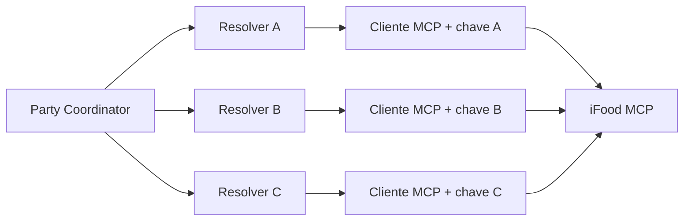

# Uma sessão MCP por participante sob um coordenador central

Cada participante da Party usará uma chave própria do iFood MCP, cadastrada durante a entrada na sala. O backend central coordenará a experiência, mas endereço, catálogo, carrinho e pedido serão operados por um cliente MCP isolado e vinculado a somente uma pessoa. Escolhemos esse desenho para preservar identidade e consentimento individuais sem introduzir agentes autônomos negociando entre si.

## Topologia

O Party Coordinator combina as respostas do grupo e, em uma etapa futura, fornecerá a cada resolver uma solicitação estruturada para montar opções locais coerentes com o tema escolhido. Cada resolver usa somente os dados e a sessão daquele participante e devolve JSON ao coordenador.

## Cadastro durante a Party

1. O participante entra na Party e recebe um token temporário.
2. Cola sua chave MCP em uma tela privada.
3. O frontend envia a chave por HTTPS.
4. A API valida a chave com uma operação de leitura do MCP.
5. A chave permanece somente em um registro privado na memória.
6. O estado público expõe apenas `not_connected`, `validating`, `connected` ou `error`.
7. A chave é descartada quando a Party termina ou o processo reinicia.

## Limites de segurança

- nunca incluir chaves em `PartySnapshot`, fixtures, prompts, logs ou erros;
- exigir o token do participante para cadastrar ou substituir sua chave;
- manter um registro privado `partyId + participantId → MCP client`;
- nunca executar uma ferramenta na sessão de outro participante;
- manter consentimento individual no futuro envio do pedido.

## Alternativas rejeitadas

**Um cliente MCP compartilhado:** pode misturar identidade, endereço, carrinho e consentimento.

**Um agente autônomo em cada dispositivo:** adiciona execução local, comunicação entre agentes e falhas distribuídas sem necessidade para o MVP.

**Uma sessão real e duas simuladas:** permanece como contingência do pitch, não como fluxo principal.

## Prova técnica do Maeda

Antes da integração:

1. criar dois clientes para o mesmo servidor MCP com chaves diferentes;
2. consultar identidade ou endereço em cada um;
3. intercalar chamadas e verificar que o contexto não vaza;
4. repetir com três clientes simultâneos;
5. confirmar que a biblioteca recebe autenticação por instância, sem variável global;
6. registrar limites, erros e dados que precisam ser sanitizados.

Se a biblioteca mantiver credenciais globalmente, cada cliente será executado em um processo trabalhador isolado. A interface com o Party Coordinator continuará a mesma.

## Responsabilidades

| Pessoa | Responsabilidade |
| --- | --- |
| Maeda | validar múltiplos clientes e implementar o adaptador MCP |
| Matheus | guardar referências privadas, autorizar participantes e coordenar as chamadas |
| Otávio | criar a entrada privada da chave e exibir somente o estado da conexão |
| Júlio | definir textos de conexão, erro e nova tentativa |
