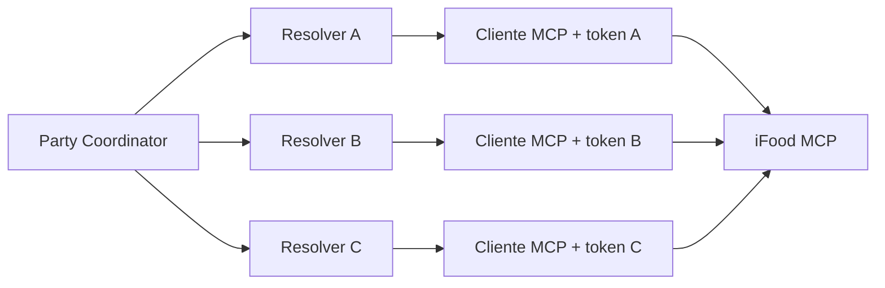

# Uma sessão MCP por participante sob um coordenador central

Cada participante da Party conectará a própria conta do iFood MCP durante a entrada na sala, por um fluxo OAuth 2.1 autorizado individualmente. O backend central coordenará a experiência, mas endereço, catálogo, carrinho e pedido serão operados por um cliente MCP isolado e vinculado a somente uma pessoa. Escolhemos esse desenho para preservar identidade e consentimento individuais sem introduzir agentes autônomos negociando entre si.

O iFood MCP usa OAuth 2.1 com PKCE: o time registra um agente (o backend) e recebe um `client_id` + `client_secret`; cada participante autoriza o agente e recebe o próprio par `access_token` + `refresh_token`. O `client_secret` identifica o aplicativo e nunca dá acesso à conta de ninguém. Detalhes em [`docs/ifood-mcp.md`](../ifood-mcp.md).

## Topologia

O Party Coordinator combina as respostas do grupo e, em uma etapa futura, fornecerá a cada resolver uma solicitação estruturada para montar opções locais coerentes com o tema escolhido. Cada resolver usa somente os dados e a sessão daquele participante e devolve JSON ao coordenador.

## Cadastro durante a Party

1. O participante entra na Party e recebe um token temporário.
2. Aciona "conectar iFood" e é levado à autorização OAuth do iFood (Web Login ou Pending Action).
3. O iFood devolve um `authorization_code` ao callback do backend.
4. A API troca o code por tokens, validando com uma operação de leitura do MCP (por exemplo `getUser`).
5. Os tokens permanecem somente em um registro privado na memória, indexados por `partyId + participantId`.
6. O estado público expõe apenas `not_connected`, `validating`, `connected` ou `error`.
7. Os tokens são descartados quando a Party termina ou o processo reinicia.
8. O `access_token` é renovado com o `refresh_token` antes de expirar.

## Limites de segurança

- nunca incluir `client_secret`, `access_token`, `refresh_token` ou codes em `PartySnapshot`, fixtures, prompts, logs ou erros;
- manter o `client_secret` somente no backend e o consentimento OAuth sempre no navegador do participante;
- exigir o token do participante para iniciar a conexão da sua sessão;
- manter um registro privado `partyId + participantId → tokens do participante`;
- nunca executar uma ferramenta na sessão de outro participante;
- manter consentimento individual no futuro envio do pedido (`userConsent: true`).

## Alternativas rejeitadas

**Um cliente MCP compartilhado:** pode misturar identidade, endereço, carrinho e consentimento.

**Um agente autônomo em cada dispositivo:** adiciona execução local, comunicação entre agentes e falhas distribuídas sem necessidade para o MVP.

**Uma sessão real e duas simuladas:** permanece como contingência do pitch, não como fluxo principal.

## Prova técnica do Maeda

Antes da integração:

1. registrar o agente (aplicativo) e obter `client_id` + `client_secret` após a homologação;
2. criar duas test accounts no sandbox;
3. autorizar cada conta pelo fluxo OAuth e guardar os dois pares de tokens;
4. consultar identidade ou endereço (`getUser`/`listAddresses`) com cada token;
5. intercalar chamadas e verificar que o contexto não vaza entre os tokens;
6. repetir com três contas simultâneas;
7. confirmar que a biblioteca/agente recebe autenticação por token, sem variável global;
8. validar o refresh do `access_token` e registrar limites, erros e dados a sanitizar.

Se a biblioteca mantiver credenciais globalmente, cada sessão será executada em um processo trabalhador isolado. A interface com o Party Coordinator continuará a mesma.

## Responsabilidades

| Pessoa | Responsabilidade |
| --- | --- |
| Maeda | validar múltiplas sessões OAuth e implementar o adaptador MCP |
| Matheus | guardar referências privadas, autorizar participantes e coordenar as chamadas |
| Otávio | criar o botão de conexão OAuth e exibir somente o estado da conexão |
| Júlio | definir textos de conexão, erro e nova tentativa |
