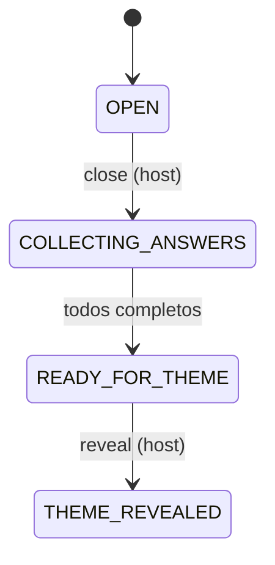

# Estado e ação de revelação do resultado da Party

A Etapa 8 do fluxo do Figma termina em "Tudo pronto! Aguarde os outros participantes…", com a lista
de participantes (Pronto / Aguardando) e um botão **"Revelar resultado"** do host. O estado
`READY_FOR_THEME` cobre "todos responderam", mas o fluxo tem um passo explícito depois disso: é o
host quem dispara a revelação, no momento social que o grupo escolher.

Este ADR fixa **a transição e o snapshot**, não o conteúdo: o *que* é revelado (tema, votação,
cardápio) continua decisão do Júlio (Marco T).

## Decisão

Adicionar o estado `THEME_REVEALED` e a ação do host:

```text
OPEN
  → POST /parties/:id/close        (host)          OPEN → COLLECTING_ANSWERS
COLLECTING_ANSWERS
  → todos enviam completed: true   (automático)
READY_FOR_THEME
  → POST /parties/:id/reveal       (host)          READY_FOR_THEME → THEME_REVEALED
THEME_REVEALED
```



Regras:

- **quem:** só o token do host (mesma regra de `close`); outro participante recebe `403`.
- **quando:** só a partir de `READY_FOR_THEME`; fora disso, `409` (estado inválido).
- **efeito:** `party.status = THEME_REVEALED` no `PartySnapshot`; todos os dispositivos veem pelo
  polling de `GET /parties/:id`, sem WebSocket.
- **idempotência:** um segundo `reveal` em `THEME_REVEALED` é `409`; não re-revela.

Contrato:

- `packages/contracts`: `PARTY_STATUSES` ganha `THEME_REVEALED`.
- `apps/api/openapi.yaml`: nova rota `POST /parties/{partyId}/reveal` (Bearer do host), respostas
  `200 PartySnapshot`, `401`, `403`, `404`, `409`.
- sem dados novos no snapshot além do `status`; o resultado em si entra quando o Marco T definir.

## Alternativas rejeitadas

**Ir a `THEME_REVEALED` automaticamente quando todos respondem.** A tela mostra um botão do host;
o momento da revelação é uma escolha do grupo, não um efeito colateral do preenchimento.

**Reusar `READY_FOR_THEME` como se já fosse o resultado.** Perde a distinção entre "todos prontos"
e "resultado revelado", que é justamente o que a Etapa 8 desenha.

**WebSocket/evento para propagar a revelação.** O polling de 1–2 s já entrega o novo status e está
fora do escopo do MVP.

## Consequências

- O frontend ganha um gatilho claro: mostrar "Revelar resultado" só para o host e só em
  `READY_FOR_THEME`; depois, renderizar o resultado em `THEME_REVEALED`.
- Estados posteriores (opções, carrinho, pedido) continuam indefinidos; este ADR não os cobre.

## Responsabilidades

| Quem | O quê |
| --- | --- |
| Sessão da API (`apps/api`, `packages/contracts`, `openapi.yaml`) | implementar estado, rota `reveal`, testes; ratificar este ADR ao implementar |
| Júlio | o que é revelado e os textos da tela de resultado |
| Esta documentação | este ADR e a atualização de [`fluxo-party-figma.md`](../fluxo-party-figma.md) |
