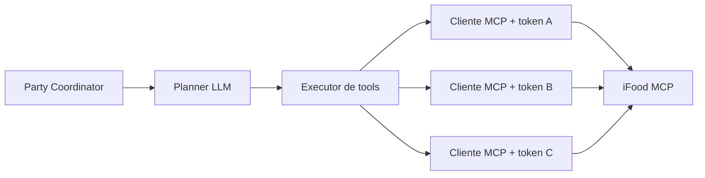

# Um planner LLM central dirigindo as tools do iFood MCP

O iFood expõe uma única superfície de integração: um servidor MCP com 23 tools
([`docs/ifood-mcp.md`](../ifood-mcp.md)). O propósito do MCP é ser consumido por um agente que
descobre e escolhe tools em tempo de execução, mas o recorte atual
(`apps/api/src/agent/resolve-options.ts`) chama as tools em ordem fixa, o que subutiliza o
protocolo e engessa o tema. Decidimos introduzir um **planner LLM que roda no coordenador** e
dirige as tools do MCP, para permitir temas livres, surpresa, substituição e itens equivalentes
entre endereços, mantendo o pipeline determinístico como fallback.

A decisão **estende** a [`ADR 0001`](0001-uma-sessao-mcp-por-participante.md), não a contradiz: a
alternativa rejeitada lá é um **agente autônomo por dispositivo**. Aqui há um único planner no
backend, servindo todos os participantes; cada chamada de tool continua usando o token isolado
daquele participante.

## Invariante

> O agente decide **intenção**; o executor resolve **fato**.

- O LLM escolhe quais tools chamar, em que ordem, com que argumentos, e pode ranquear, descrever e
  sugerir substitutos.
- IDs, preços, disponibilidade, frete, pedido mínimo, endereços e consentimento **só** vêm do MCP.
  Nenhuma saída do modelo é usada como ID.
- Toda proposta é revalidada: a intenção vira chamada MCP e `buildOption` refaz as contas.

## Topologia

## Limites de segurança

- nunca incluir `client_secret`, `access_token`, `refresh_token`, códigos ou a chave do modelo em
  prompts, logs, `PartySnapshot`, fixtures ou erros;
- prompts só com dados públicos ou sanitizados (bairro e cidade; nunca rua, CEP, telefone, e-mail);
- allowlist de tools; nenhuma escrita sem `userConsent: true`;
- saída do modelo tratada como não confiável, validada contra schema e catálogo;
- ausência de `OPENCODE_API_KEY` faz o sistema cair no determinístico, sem quebrar testes.

## Alternativas rejeitadas

**Substituir o MCP por uma "API" própria:** não existe — a superfície de consumidor concedida ao
time é o MCP; as bases `/v3/*` são documentação geral, não verificadas.

**Agente autônomo por dispositivo:** continua rejeitado pela [`ADR 0001`](0001-uma-sessao-mcp-por-participante.md)
(execução local, comunicação entre agentes e falhas distribuídas sem necessidade).

**Deixar o LLM escolher IDs e preços:** alucina item; quebra a transação e o orçamento.

**Tornar o LLM obrigatório:** acopla a demo a custo, latência e disponibilidade de um provedor.

## Consequências

- o tema deixa de ser uma tabela fixa e passa a admitir texto livre;
- o caminho determinístico permanece como fallback e como modo sem chave;
- surge dependência operacional de um provedor de LLM (optativa);
- o ensaio e o pitch podem precisar de um plano "pinado" para reprodutibilidade.
