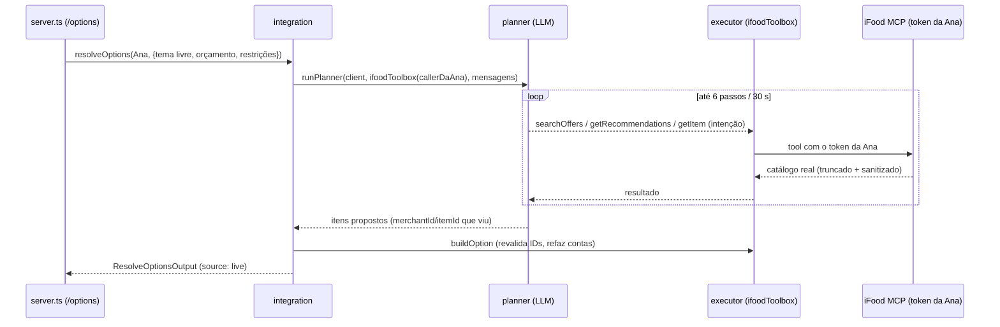

# Plano — Planner LLM sobre o iFood MCP

> Companheiro de [`spec do agente LLM`](../specs/2026-10-17-agente-llm-ifood-mcp.md) e do
> [`ADR 0003`](../../adr/0003-planner-llm-sobre-ifood-mcp.md). O commit `b8bb662` ("add LLM planner
> skeleton") trouxe as peças, mas **nada ainda as chama no fluxo**. Este documento explica primeiro
> **como o planner seria usado** e depois o **passo a passo para ligá-lo**.

## 0. Resumo em uma frase

Hoje o `POST /parties/:id/options` transforma um tema em buscas por uma **tabela fixa**
(`themes.ts`: `italiano` → `massa`, `pizza`, `lasanha`). Com o planner, um **LLM central** escolhe
sozinho **quais tools do iFood chamar e com quais termos**, permitindo tema livre, substitutos e
surpresa — mas **sem nunca escolher preço ou ID**: quem resolve isso continua sendo o MCP.

Invariante da spec:

> O agente decide **intenção**; o executor resolve **fato**.

## 1. O que já existe (e o que ainda não)

| Peça | Arquivo | Estado |
| --- | --- | --- |
| Cliente do LLM (OpenAI-compatible) | `apps/api/src/llm/client.ts` | pronto (`OpenCodeClient implements ChatClient`) |
| Config do LLM (opcional) | `apps/api/src/llm/config.ts` | pronto (`loadOpenCodeConfig` → `undefined` sem chave) |
| Loop de tool-calling | `apps/api/src/agent/planner.ts` (`runPlanner`) | pronto: allowlist, validação de args, limite de passos (6), timeout (30 s), resultado truncado |
| Allowlist das tools do iFood | `apps/api/src/agent/planner.ts` (`ifoodToolbox`) | pronto: `listAddresses`, `getUserProfile`, `getRecommendations`, `searchOffers`, `getItem` |
| Sanitização para o prompt | `apps/api/src/agent/sanitize.ts` | pronto (`stripPersonalData`, `sanitizeAddress`) |
| Testes | `planner.test.ts`, `sanitize.test.ts`, `llm/*.test.ts` | verdes no script `test` |
| **Ligação no fluxo** | `agent/integration.ts` / `server.ts` | **não existe** — ninguém importa `runPlanner` fora dos testes |
| Tools próprias do sistema | `themeFromAnswers`, `proposeSubstitutes`, `describeOption`, `rankOptions` | **não existem** |
| Negociação de grupo | agregar `PartyOptionsResult[]` e replanejar | **não existe** |

Ou seja: o "skeleton" tem motor e volante, mas não está ligado no chassis. O carro anda hoje pelo
caminho determinístico de sempre.

## 2. Como seria utilizado — o fluxo, com exemplo

### Sem `OPENCODE_API_KEY` (hoje, e continua valendo)

Nada muda. `integration.resolveOptions` → `resolveOptionsWithFallback` → `resolve-options.ts`
(tabela de tema, busca, `buildOption`, `rankOptions`). É o fallback e o modo sem chave de LLM.

### Com `OPENCODE_API_KEY` (o caminho novo)

Suponha `POST /parties/:id/options` para a **Ana**, endereço único (Casa), com:

```json
{ "theme": "comida de vó", "budget": 60, "restrictions": ["vegetariano"] }
```

Passo a passo do que aconteceria:

1. **Montar o contexto (executor, não o modelo).** O executor lê o endereço via `listAddresses`
   e monta a mensagem inicial com: tema, orçamento, restrições e a **lista sanitizada** de
   endereços (`{ addressId, label: "Casa, São Carlos" }`) — nunca rua, número, CEP ou coordenada.
   O perfil entra por `getUserProfile` já passando por `stripPersonalData`.
2. **O modelo planeja (intenção).** Em vez de `themeQueries("comida de vó")` dar nada, o modelo
   decide consultar, por exemplo, `searchOffers(query: "feijoada")`,
   `searchOffers(query: "macarrão com queijo")`, `searchOffers(query: "bolo de vó")`.
3. **O executor roda cada tool no MCP, com o token da Ana.** O `ifoodToolbox` recebe o
   `ToolCaller` da sessão dela; o resultado volta **truncado** (4 000 chars) e sanitizado. O loop
   repete até o modelo parar, estourar 6 passos ou 30 s.
4. **O modelo propõe (ainda intenção).** Ele devolve **quais itens viu** que servem
   (por `merchantId` + `itemId` que o MCP retornou) e a ordem/descrição. Ex.: "a feijoada vegetariana
   da Casa do Norte e o macarrão da Cantina".
5. **O executor revalida e calcula (fato).** Para cada item proposto, ele confere que o `itemId`
   **apareceu de fato numa resposta desta sessão** (whitelist do que o MCP devolveu), roda
   `getItem` + `buildOption` de novo e refaz preço, quantidade e mínimo. ID que o
   modelo "inventou" é descartado.
6. **Resposta.** Sai o mesmo `ResolveOptionsOutput` de hoje (`source: "live"`, até 3 opções), que o
   `POST /options` já sabe devolver. O resto do fluxo (`/cart`, `/order`) **não muda em nada**.
7. **Se algo falhar** (LLM fora, timeout, JSON ruim, sem progresso) → cai no determinístico. A
   falha de um participante não derruba os outros (mesma regra de `resolveOptionsForParty`).



O que o LLM **nunca** faz: escolher preço, frete, ID que não viu, nem escrever (carrinho/pedido).
Escrita continua determinística no marco D, exigindo `userConsent: true`.

## 3. Onde cada peça se encaixa

```text
server.ts  POST /parties/:id/options
   └─ options.agent.resolveOptions(actor, input)        ← interface PartyAgentIntegration
        └─ createIfoodIntegration (agent/integration.ts) ← ponto de ligação
             ├─ (hoje) resolveOptionsWithFallback → resolve-options.ts   [determinístico]
             └─ (novo) runPlanner(client, ifoodToolbox(callerDoParticipante), mensagens)
                          ├─ llm/client.ts        (OpenCodeClient lê OPENCODE_*)
                          ├─ agent/planner.ts     (loop, allowlist, limites)
                          └─ agent/sanitize.ts    (o que o modelo pode ver)
```

Pontos-chave:

- `clientFor(actor)` da integração já devolve o `ToolCaller` com **o token daquele participante** —
  é esse caller que a `ifoodToolbox` usa, então o isolamento por participante se mantém.
- `loadOpenCodeConfig(env)` já existe e devolve `undefined` sem chave. É o interruptor: com config,
  planner ligado; sem, determinístico.
- `runPlanner` recebe um `ChatClient`. Nos testes usa um `ChatClient` falso; em produção,
  `new OpenCodeClient({ config })`.
- O `planner.ts` é **genérico** de propósito: ele não conhece iFood. Quem conhece é a `ifoodToolbox`.

## 4. Decisão de desenho (recomendada, a confirmar)

O esqueleto para o loop e devolve **texto**. O que ainda não existe é o passo que transforma a
intenção do modelo em `LocalOption[]`. A recomendação:

- **adicionar uma tool de finalização** à toolbox (ex.: `proposeOptions`), que o modelo **deve**
  chamar com `[{ merchantId, itemId, quantity }]`;
- o executor só aceita IDs que **já apareceram** em resposta do MCP nesta execução (whitelist) e
  então roda `getItem` + `buildOption` — reusando toda a aritmética atual;
- se o modelo parar sem chamar `proposeOptions`, cai no determinístico.

Alternativa mais simples (menos "agente"): o modelo só devolve **os termos de busca** e o pipeline
determinístico faz o resto. É menos flexível (não ranqueia/descreve), mas é o menor risco. Vale
decidir qual das duas entra no pitch.

## 5. Passo a passo de implementação

| # | Task | Arquivos | Pronto quando |
| --- | --- | --- | --- |
| ✅ P1 | Montar as mensagens iniciais (tema, orçamento, restrições, endereços sanitizados) | `agent/planner-context.ts` | feito: `planner-context.test.ts` |
| ✅ P2 | Tool de finalização `proposeOptions` + whitelist dos IDs vistos | `agent/planner.ts` | feito: ID inventado é descartado (`planner.test.ts`) |
| ✅ P3 | Traduzir a proposta em `LocalOption[]` reusando `getItem` + `buildOption` | `agent/planner-options.ts` | feito: proposta vira até 3 opções, com o orçamento como referência (`planner-options.test.ts`) |
| ✅ P4 | Ligar na integração: com config → planner; alguns erros → determinístico | `agent/integration.ts`, `server.ts` | feito: sem chave = caminho de hoje; com `ChatClient` = planner (`fallback.test.ts`) |
| ✅ P5 | Timeout/limite e degradação sem quebrar os outros participantes | `agent/fallback.ts` | feito: planner travado degrada pro determinístico (`fallback.test.ts`) |
| ✅ P6 | Tools próprias: `themeFromAnswers`, `proposeSubstitutes`, `describeOption`, `rankOptions` | `agent/planner-tools.ts` | feito: substituto só aponta para o que existe (`planner-tools.test.ts`) |
| ✅ P7 | Negociação de grupo sobre `PartyOptionsResult[]` | `agent/negotiate.ts` | feito: endereço sem o tema migra para um tema comum (`negotiate.test.ts`) |
| P8 | Config no deploy e pin da demo | `compose.yaml`, `.env.example`, `docs/*` | `OPENCODE_*` documentado; plano "pinado" para o ensaio |

> `compose.yaml` e `.env.example` **já** têm `OPENCODE_API_KEY`, `OPENCODE_MODEL` e
> `OPENCODE_BASE_URL` (vieram no `b8bb662`, e o compose também recebeu `IFOOD_*`).
> Só falta o código consumir `loadOpenCodeConfig`.

**P1–P5 entregues e testados.** O agente agora está **ligado e opt-in**: em `MCP_OAUTH_MODE=ifood`,
se `loadOpenCodeConfig()` achar `OPENCODE_API_KEY` o `server.ts` injeta um `OpenCodeClient` na
integração; sem a chave, o comportamento é exatamente o de antes (determinístico + fixture).

**P6–P7 também entregues**: as tools do sistema (`planner-tools.ts`) e a negociação de grupo
(`negotiate.ts`). A negociação é **determinística** (tenta os temas conhecidos e re-resolve todos);
um orquestrador com LLM pode injetar a lista `alternatives` vinda do modelo. Falta **ligar P6/P7 no
fluxo**: hoje a `integration` só usa o planner por participante; a negociação precisa ser chamada
por quem orquestra a revelação do tema (área do Matheus, junto com o `deriveTheme`).

## 6. Como testar e como ensaiar a demo

- **Testes de unidade**: `npm test` (o `planner.test.ts` já usa um `ChatClient` falso — o loop é
  testável sem rede e sem chave).
- **Teste manual sem chave**: suba a API sem `OPENCODE_API_KEY`. O comportamento tem que ser
  **idêntico** ao de hoje; esse é o critério do B11.
- **Teste manual com chave**: defina `OPENCODE_API_KEY` (e, se quiser, `OPENCODE_MODEL`) e chame
  `POST /parties/:id/options` com um tema livre. Conferir logs sem segredo e opções com IDs reais.
- **Demo**: por causa do não-determinismo (mesmas respostas → tema diferente), a spec sugere
  **pinar** um plano do ensaio e reusá-lo no pitch; ter `fallback.ts` (fixture) como plano B.

## 7. Riscos

| Risco | Mitigação |
| --- | --- |
| Latência (MCP lento + idas ao modelo) | timeout total + limite de passos + paralelismo por participante |
| Não-determinismo no pitch | pin do plano; fallback determinístico |
| Custo/disponibilidade do provedor | chave opcional; degradação automática |
| Alucinação de item/preço | invariante "nunca ID"; só o MCP fornece IDs e valores; whitelist |
| Vazamento de dado pessoal no prompt | `sanitizeAddress` / `stripPersonalData` antes de cada mensagem |

## 8. Responsabilidades

| Quem | O quê |
| --- | --- |
| Maeda | expor as tools do MCP ao executor, sanitização e validar substituição contra o catálogo (P1–P3, P6) |
| Matheus | orquestrar o loop na integração, negociação de grupo e o invariante "nunca ID" (P4, P5, P7) |
| Júlio | regra de tema em produto e os textos do agente |
| Otávio | exibir andamento do agente e troca de tema na interface |

## 9. Pendências de documentação

- `ADR 0003` está **proposed**; ratificar quando P4 subir.
- O `README.md` lista "agentes autônomos negociando entre si" como limite — a spec pede revisar a
  frase (o planner é **um** agente central, não autônomo por dispositivo).
- `docs/marcos.md` B11 ("LLM só para ranquear/descrever") fica **ampliado** por esta spec.
